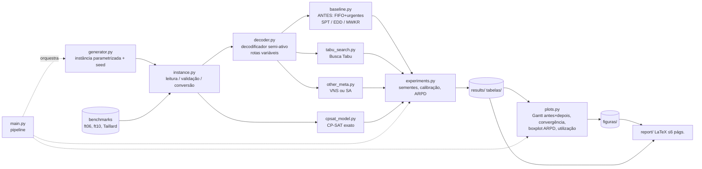

[README.md](https://github.com/user-attachments/files/35127630/README.md)
# Otimização do Sequenciamento da Produção de Mostruários com Job Shop Scheduling

Projeto prático de **Pesquisa Operacional II** (UFC – Engenharia de Produção, Prof. Bruno de Athayde Prata).
Autor: Juan de Oliveira Brasil — matrícula 571942.

## Objetivo

Ordens de produção de mostruários passam por várias estações de trabalho e hoje são sequenciadas de forma empírica (ociosidade, atrasos, custo). O projeto modela o problema como **Job Shop Scheduling (JSSP)** com roteiros variáveis, minimiza o **makespan** respeitando precedências e compara **ANTES** (prática atual simulada) × **DEPOIS** (sequência otimizada).

Métodos:

1. **Busca Tabu** (heurística).
2. **CP-SAT / OR-Tools** (exato, com limite de tempo; status OPTIMAL/FEASIBLE e gap).
3. **Outra metaheurística** (VNS ou SA) e **regras de despacho** (FIFO+urgentes, SPT, EDD, MWKR).

Métricas: Cmax (principal), ΣTj, Tmax, ΣUj, ociosidade e utilização por estação, ganho % vs. baseline, ARPD.

## Arquitetura



Representação da solução: permutação com repetição, em que o job *j* aparece |rota_j| vezes (a k-ésima ocorrência é a k-ésima operação do job). O decoder próprio é validado contra o `scheptk` em instâncias de rota completa.

## Estrutura de pastas

```
.
├── README.md            este arquivo
├── ESCOPO.md            escopo, premissas, protocolo experimental, cronograma
├── requirements.txt     dependências Python
├── main.py              pipeline: gera/carrega → ANTES → otimiza → compara → salva
├── data/
│   ├── instances/       instâncias geradas (CSV + TXT scheptk quando rota completa)
│   └── benchmarks/      ft06, ft10, Taillard (valores ótimos conferidos na fonte)
├── src/                 módulos (generator, instance, decoder, baseline,
│                        tabu_search, cpsat_model, other_meta, experiments, plots)
├── tests/               decoder × scheptk; solução do CP-SAT validada pelo decoder
├── results/             saídas brutas dos experimentos (CSV/JSON)
├── tabelas/             tabelas finais para o relatório
├── figuras/             gráficos finais (PDF/PNG)
└── report/              template abnTeX2 do SIGAA preenchido (main.tex, capa.tex,
                         resumos.tex, conteudo.tex, referencias.bib, figuras/)
```

## Reprodução (quando o código estiver pronto)

```bash
python -m venv .venv && .venv/Scripts/python -m pip install -r requirements.txt
.venv/Scripts/python main.py --stage base                   # caso-base n=25: ANTES × DEPOIS
.venv/Scripts/python main.py --stage experiments            # benchmarks, calibração, comparação, sensibilidade
.venv/Scripts/python main.py --stage all --runs 30 --budget 20000 --cp-time 30 --jobs 12   # execução completa
.venv/Scripts/python main.py --stage all --quick            # versão reduzida
.venv/Scripts/python -m pytest tests
```

Saídas: `results/` (CSV/JSON brutos), `tabelas/` (tabelas finais), `figuras/` (Gantt, convergência, boxplot de ARPD, utilização), `data/instances/` (instâncias geradas).

## Status

Pipeline implementada (gerador, decoder, baseline, Busca Tabu, SA, CP-SAT, experimentos, gráficos, testes). Relatório em `report/relatorio.pdf` (fonte: `relatorio.html`, fórmulas em LaTeX via KaTeX); a versão LaTeX completa está em `report/*.tex`. Ver [ESCOPO.md](ESCOPO.md).
